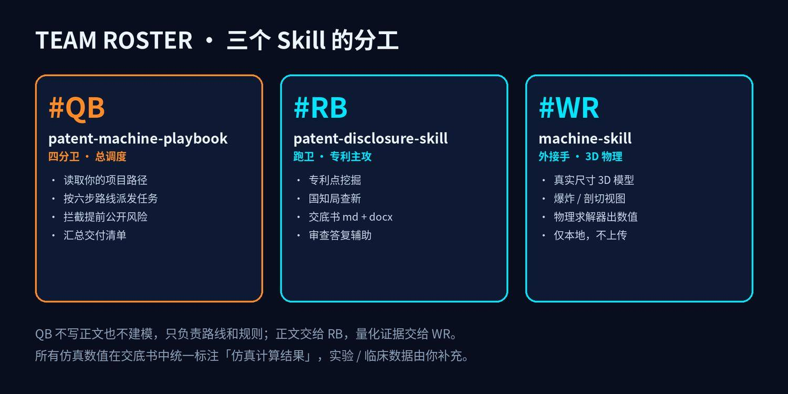
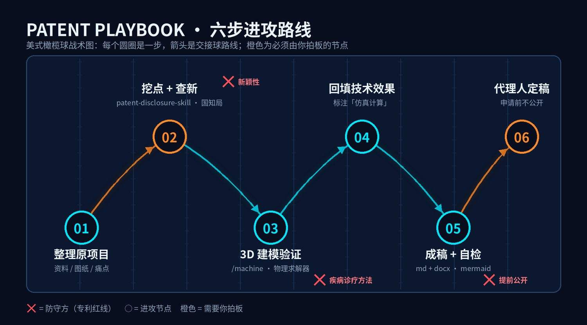

<p align="center"></p>

<h1 align="center">专利战术板 · Patent Playbook</h1>

<p align="center"><b>把一个原有项目，按橄榄球战术路线推进成发明专利交底书。</b><br>
串联 <a href="https://github.com/TUANZIDING/patent-disclosure-skill">patent-disclosure-skill</a>（挖点 / 查新 / 交底书）与 <a href="https://github.com/AirsupHQ/machine-skill">machine-skill</a>（3D 建模 / 物理求解）的 Claude Code 总调度技能。</p>

---

## 一句话结论
**专利正文交给 patent-disclosure-skill，量化证据交给 machine-skill，本技能只管路线和红线。**

## 阵容



| 位置 | 技能 | 职责 |
|---|---|---|
| QB 四分卫 | patent-machine-playbook（本仓库） | 读项目、派任务、守红线、出交付清单 |
| RB 跑卫 | patent-disclosure-skill | 专利点挖掘、国知局查新、交底书 md + docx |
| WR 外接手 | machine-skill | 真实尺寸 3D 模型、剖切 / 爆炸视图、物理求解器数值 |

## 六步进攻路线



1. **整理原项目**：填 `templates/项目输入清单.md`
2. **挖点 + 查新**：候选 3–5 个点，国知局对比 → 你选点
3. **3D 建模验证**：`/machine` 建模，记录公式、输入、输出
4. **回填技术效果**：数值统一标注「仿真计算结果」
5. **成稿 + 自检**：md + docx
6. **交付清单**：待补数据、代理人确认点、公开风险自查 → 你确认

## 三条红线
- 🚫 **申请前不公开**：3D 页面、视频、截图只留本地
- 🚫 **疾病诊疗方法不可专利**（专利法第 25 条）：写成装置 / 系统
- 🚫 **仿真不冒充实验**：实验 / 临床数据由你补充

## 安装

```bash
git clone https://github.com/TUANZIDING/-patent-machine-playbook.git
bash patent-machine-playbook/scripts/install.sh
```

## 使用

```text
/patent-machine-playbook ~/Projects/我的器械资料
```

或直接粘贴：

```text
我要把一个原有项目改进成发明专利。项目资料在：<路径>。
按 patent-machine-playbook 的六步路线执行：先挖点查新给我选，
选定后用 /machine 本地建模验证，仿真数值写入技术效果并标注，
最后输出交底书 md + docx 和交付清单。任何文件不得上传或公开。
```

## 目录结构

```
patent-machine-playbook/
├── SKILL.md                 # 总调度：六步路线 + 铁律
├── README.md
├── assets/                  # 封面、阵容图、路线图
├── docs/workflow.md         # 分工原因、红线、适用范围
├── templates/
│   ├── 项目输入清单.md
│   └── 交付清单.md
└── scripts/install.sh       # 一键安装三个技能
```

## 声明
本工具辅助撰写技术交底书，不构成法律意见；正式申请文件请由专利代理师定稿。

## 致谢 & 许可
- [AirsupHQ/machine-skill](https://github.com/AirsupHQ/machine-skill) · MIT
- [handsomestWei/patent-disclosure-skill](https://github.com/handsomestWei/patent-disclosure-skill) · MIT
- 本仓库 · MIT © 2026 Haixiang Ding
